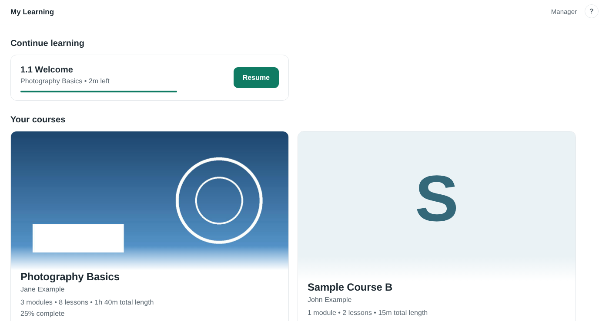
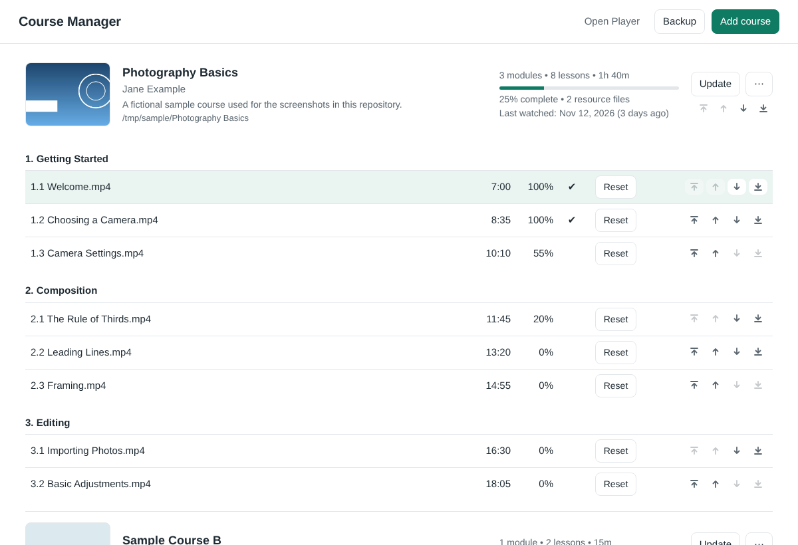

# Local Course Player

A local web app for watching your own course videos. It adds progress tracking, resume, notes, subtitles, and a course-site layout to folders of video files, without moving, copying, or converting them.

It runs on your computer. There is no account, no cloud service, and no upload. Progress, notes, and settings are stored in a `data` folder next to the program.



*Screenshots use fictional sample data.*

## Who it is for

People who keep downloaded or recorded courses in folders and want to study them like an online course: modules, a resume button, per-lesson progress, and notes.

## Features

**Player**

- Course home with a "Continue learning" bar that opens the lesson you watched last, across all courses.
- Course page with modules built from folders, a progress ring, and status marks (completed, in progress, current).
- Video controls: play, pause, seek, volume, speed (0.5x to 2x), subtitles, full screen. Controls hide in full screen and show the lesson title when you move the mouse.
- Resume from the last position. The position is saved every 5 seconds and when you pause, seek, switch lesson, finish, or close the page.
- A lesson is marked complete once when you pass 95%. You can also mark or unmark it by hand.
- A note for every lesson and for every course home page (up to 20000 characters).
- Bookmarks with a note at a time point in a lesson. Select a bookmark to jump to that time.
- Click the circle next to a lesson to mark it complete or not complete, or use the check button on a module heading to mark the whole module.
- Each course shows when you last watched it, for example `Nov 12, 2026 (3 days ago)`.
- Resource files from the lesson's folder open in your default Windows app.
- Subtitles from `.srt` or `.vtt` files, with an on and off button and a track menu when a lesson has more than one track.
- Resizable lesson list. The width is remembered per course.

**Manager**

- Add several courses. Each course is one folder that you pick.
- Update a course after you add, rename, or move files. Progress is kept for videos whose file name did not change.
- Change the location of a course (for example after moving the folder to another drive).
- Edit name, author, and description. Add a cover image.
- Reorder courses and lessons. Reset progress for a course or for one lesson.
- Export and import all settings, progress, notes, and cover images in one zip file.



## Requirements

| Item | Requirement |
|---|---|
| Operating system | Windows 10 or 11. Resource files and the automatic browser start use `explorer.exe`. |
| Node.js | Developed and tested on Node.js 24. Older versions are not tested. |
| Browser | Chrome or Edge (Chromium based). Other browsers are not tested. |
| Packages | None. There is no `npm install` step. |
| `curl` | Used by `stop.bat`. It is included in Windows 10 and 11. |

## Quick start

1. Download or clone this repository. Keep the `public` folder next to `server.js`.
2. Double-click `start-manager.bat`. A command window opens, the server starts, and the Manager opens in your browser at `http://127.0.0.1:3211/manager.html`.
3. Select **Add course**. In the folder browser, click folders to open them, or type or paste a full path. Tab completes the first matching folder name. Select the folder that holds one course. The Manager scans the folder and reads the duration of every video in your browser. A large course can take a while.
4. Select **Open Player**, or double-click `start.bat` next time, and pick a course.
5. Close all browser tabs of the app when you are done. The server stops about 5 seconds later.

You can also stop the server by closing the command window or running `stop.bat`.

## Course folder layout

```
My Course/                   the folder you choose in the Manager (one course)
  1. Getting Started/        a module (first-level folder)
    1.1 Welcome.mp4          a lesson
    1.1 Welcome.srt          subtitles for that lesson
    Camera Checklist.pdf     a resource for lessons in this folder
  2. Composition/
    2.1 The Rule of Thirds.mp4
  Course Outline.pdf         a resource shown on the course home page
```

Rules:

- Video extensions: `.mp4`, `.webm`, `.mov`, `.m4v`. Playback depends on the codecs your browser supports. `.mkv` files are not treated as videos.
- Modules and lessons sort in natural order (2 before 10). You can set a custom order in the Manager.
- Video file names must be unique within a course, ignoring case. If two videos share a name, the course is not added and both paths are listed.
- Progress is stored by video file name. Moving a file to another folder keeps its progress. Renaming a file starts a new record.
- Subtitle files use the video's name, optionally followed by a language tag, for example `Lesson.srt` or `Lesson.zh-TW.srt`. SRT is converted to WebVTT when served. Files are read as UTF-8 with GBK as a fallback.
- Every other file in a lesson's folder is a resource for that lesson. Executable and script files (`.exe`, `.bat`, `.cmd`, `.ps1`, `.msi`, `.vbs`, `.js`, `.lnk`, `.reg`, `.jar`, `.dll`, `.sh` and similar) are not listed. Hidden files, `Thumbs.db`, and `desktop.ini` are skipped.
- Folders whose names start with a dot are skipped.

## Using the Manager

| Task | How |
|---|---|
| Add a course | **Add course**, then browse to the course folder or type its full path. |
| Rescan after files change | **Update**. |
| Folder moved or renamed | Menu **...**, **Change location**, then choose the new folder. |
| Name, author, description | Menu **...**, **Edit details**. |
| Cover image | Menu **...**, **Change image**. The browser shrinks it to at most 720 px high and the app saves it as a JPEG in `data/covers`. |
| Reorder | Use the move buttons. Top and bottom stay inside the lesson's folder. **Restore default order** resets one folder after you confirm. |
| Reset progress | Menu **...**, **Reset progress** for the course, or **Reset** on a lesson under **Show lessons**. |
| Remove a course | Menu **...**, **Remove course**. This deletes the course entry and its progress. Video files and notes are not touched. |
| Back up | **Backup**, then **Export all** or **Import all**. Import replaces the current courses and progress. |

## Using the Player

Keyboard shortcuts (also available from the **?** button):

| Key | Action |
|---|---|
| Space | Play or pause |
| Left, Right | Back or forward 5 seconds. Hold to go faster. |
| Up, Down | Volume up or down 5% |
| Home, End | Jump to the start or the end |
| 0 to 9 | Jump to 0% to 90% of the video |
| M | Mute or unmute |
| C | Subtitles on or off |
| F | Full screen on or off |
| Esc | Exit full screen |

Click the video to play or pause. Double-click it to toggle full screen. When a video ends, the Player does not start the next lesson, and it leaves full screen.

## How it works

**Add a course**

- Trigger: you select **Add course** in the Manager.
- Inputs: the folder path you choose or type.
- What happens:
  1. The server scans the folder. It only reads file names and sizes.
  2. The server stops if two videos share a file name.
  3. The browser loads the metadata of each video to read its duration.
  4. If every duration is readable, the course is saved. Otherwise the course is discarded and the unreadable files are listed.
- Outputs: an entry in `data/settings.json` and a file list in `data/index/<course id>.json`.

**Play a lesson**

- Trigger: you select a lesson in the Player.
- Inputs: the saved position for that lesson.
- What happens: the server streams the file with HTTP range requests, which lets the browser seek. The page sends the position to the server while you watch.
- Outputs: the position, duration, percentage, and completed flag in `data/progress.json`.

**Stop the server**

- Trigger: you close the last Player or Manager tab.
- Inputs: a heartbeat, which is a small request every open page sends once per second, and a goodbye request sent when a page closes.
- What happens: the server exits about 5 seconds after the last page says goodbye. If a browser is killed without a goodbye, the server exits after 90 seconds without a heartbeat. The server does not exit before the first page connects.
- Outputs: the command window closes.

## Data and privacy

- All data lives in the `data` folder next to `server.js`: `settings.json`, `progress.json`, `notes.json`, `index/`, and `covers/`. Files are written to a temporary file first and then renamed, and the previous version is kept as `.bak`.
- `data/` contains your folder paths, progress, and notes. The included `.gitignore` excludes it. Do not commit it.
- The server listens on `127.0.0.1` only and rejects requests whose `Host` or `Origin` header is not `localhost` or `127.0.0.1`. The pages load no external scripts, fonts, or images. The app sends no telemetry.
- The folder browser in the Manager asks the server for the names of subfolders and for a video count. The server returns folder names and a number, never file contents.
- Video files are read-only. The app never copies, moves, or changes them.
- The app deletes only two kinds of files. It deletes a course image in `data/covers` when you confirm **Remove image**. It deletes its own file list cache in `data/index` when a course is removed or a failed add is discarded.
- Resource files open only if they are in the stored file list of a course. The browser sends a relative path, not a full path.

## Configuration

- Port: change the `PORT` constant at the top of `server.js` (default `3211`). Also update the port in `stop.bat`.
- `HB_TIMEOUT`: environment variable, in milliseconds. It sets how long the server waits without a heartbeat before it treats a page as gone (default `90000`).

## Project structure

```
server.js              HTTP server, scanning, progress, notes, backup
start.bat              start the server and open the Player
start-manager.bat      start the server and open the Manager
stop.bat               ask a running server to exit
public/
  player.html          Player page
  manager.html         Manager page
  common.css           shared colors and fonts
  common.js            heartbeat and "server stopped" notice
docs/screenshots/      images used in this README
data/                  created at run time, not committed
```

The project has no build step and no runtime dependencies.

## Limitations

- Opening resource files and the automatic browser start use `explorer.exe`, so they work on Windows only. Other systems are not supported.
- Single user. The server has no login, so any program on the same computer can send requests to it while it runs.
- Desktop layout only. There is no phone or tablet layout.
- `.mkv` and other formats outside the list above are not played. A video whose codec your browser cannot decode also blocks **Add course**, because its duration cannot be read.
- The repository has no automated test suite.
- Large libraries have not been benchmarked.

## Troubleshooting

| Symptom | Cause and fix |
|---|---|
| The browser shows "Not found" | The `public` folder is not next to `server.js`. Extract the whole download. |
| **Add course** shows "Enter a full folder path" | Type a full path such as `E:\Courses`, or click folders in the dialog. |
| "This video is missing or cannot be played" | The file was moved or deleted, or the browser cannot decode its codec. Run **Update** after moving files. |
| A banner says the server has stopped | The server exited. Start it again with `start.bat` and reload the page. |
| Nothing happens when the server starts | Another copy may already be running on the same port. Open `http://127.0.0.1:3211/manager.html`. |

## Reporting problems

Open an issue with your Windows version, the output of `node -v`, your browser, and the steps to reproduce the problem. Do not attach video files or the contents of `data/`.

## License

MIT License. See the `LICENSE` file.
